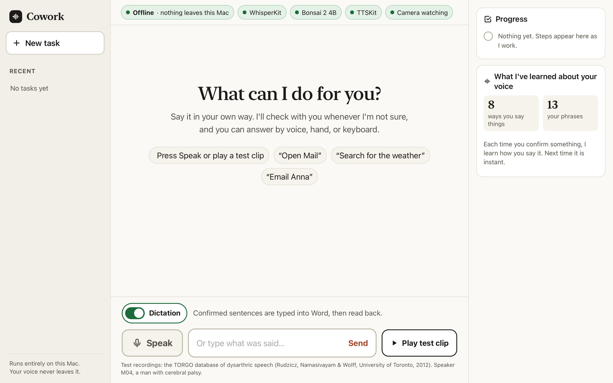
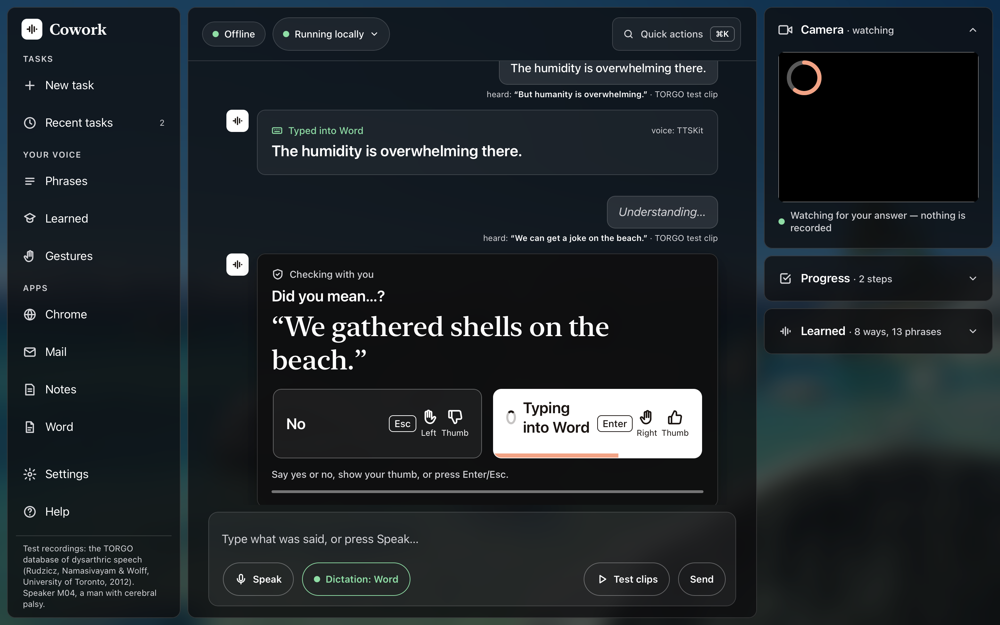
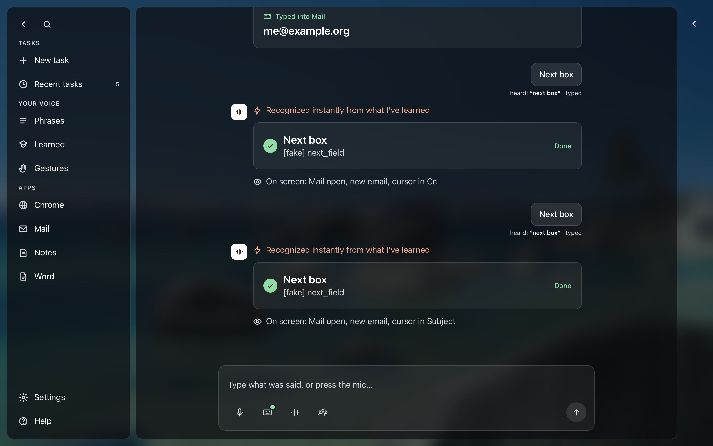
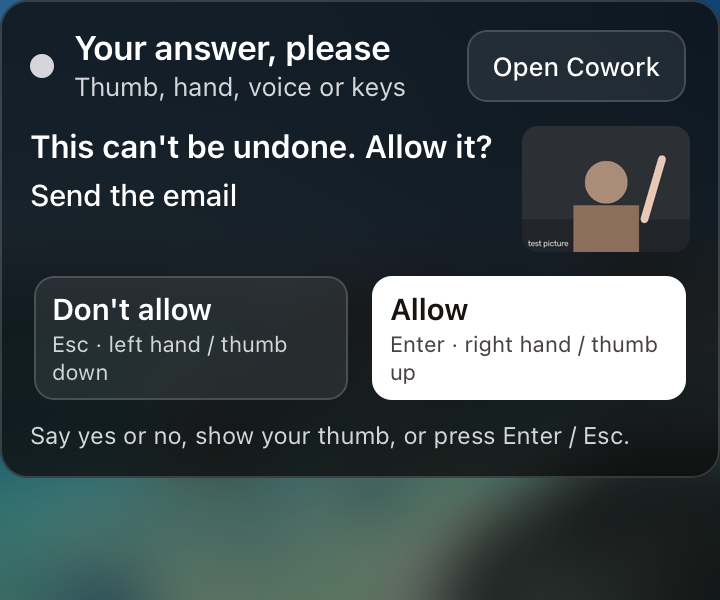
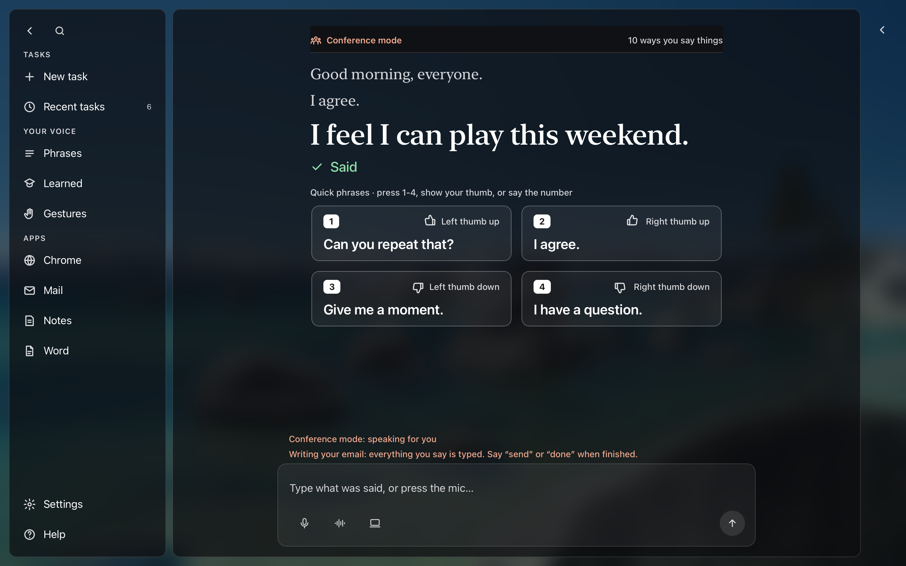
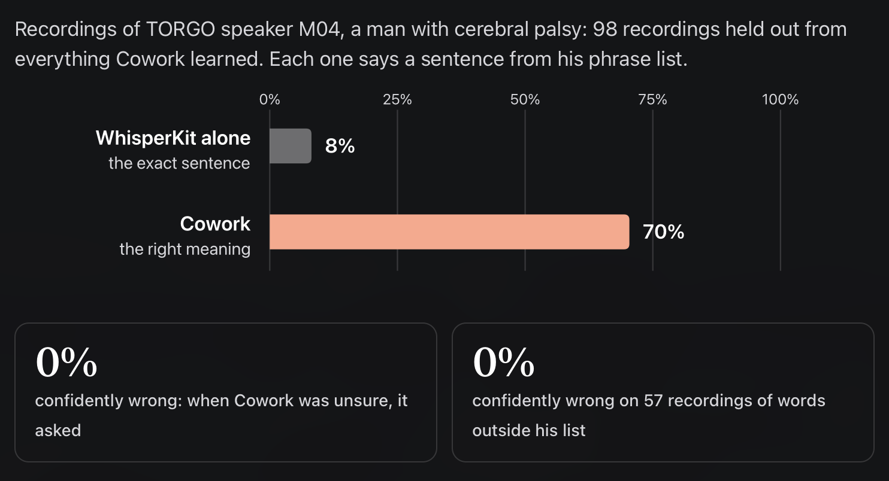
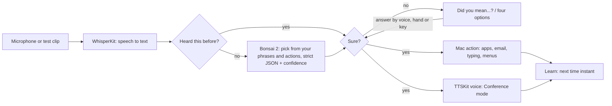

# Cowork (Second Voice)

Cowork is an unofficial, fully offline recreation of an AI computer assistant, built so that people with ALS,
Parkinson's, cerebral palsy and other speech or motor impairments can use their computer and speak in meetings.
Everything runs on a MacBook Air: no internet, no cloud, no account.

> Unofficial recreation, not affiliated with Anthropic. Demo video: VIDEO_LINK_HERE

## Why

Speech recognition works well for most voices, but it fails badly on dysarthric speech (speech affected by
Parkinson's, ALS, stroke or cerebral palsy). On our own test with the TORGO database, WhisperKit got 78% of the
words wrong for a speaker with cerebral palsy, and wrote the exact sentence only 8% of the time. The people who
would gain the most from talking to their computer are the ones it understands least.

My grandfather had Parkinson's. As his speech got harder to understand, the technology around him stopped
listening to him, and so did more and more people. Cowork is built for him and for people like him: it doesn't
need perfect speech, it works out what you meant, and it checks with you in a way you can always answer.

## What it does

- **Understands what you meant, not just what was heard.** It never guesses freely: it picks from a short list,
  your own phrases and the actions possible on screen. Sure: it acts. Unsure: "Did you mean...?" or four options.
- **Answer any way you can.** Say yes or no, show a thumb or raise a hand (camera), or press a key. Answers in
  whole sentences work too: "No, I meant to say open Microsoft Word."
- **Uses your Mac.** Opens apps, writes an email box by box, replies, forwards, types what you dictate into Word,
  and anything else through the app's own menus ("print this", "zoom in"). Risky actions (send, delete, quit,
  buy) always ask first. Undo within 3 seconds.
- **Gets out of the way.** When another app is in use, Cowork shrinks to a small window in the corner that never
  takes your keyboard, and keeps listening hands-free.
- **Speaks for you in meetings (Conference mode).** Each sentence you confirm is said aloud to the room in a
  natural voice (TTSKit). Nothing is said before you confirm it. Quick phrases: "Can you repeat that?", "I agree".
- **Learns your voice.** Every confirmed answer is remembered, so next time it is instant. "Teach me": say a
  phrase a few times and it learns how you say it.
- **Dictation that understands editing.** "comma", "period", "new paragraph", "delete that"; numbers, times and
  dates written sensibly and checked with you first.
- **Stop anything.** Say "stop" or press Esc twice.

| A question you can answer by hand | Writing an email box by box |
|---|---|
|  |  |
| **The mini window while you work** | **Conference mode** |
|  |  |

## How it uses Bonsai and Argmax

| Part | Model | How |
|---|---|---|
| Listening | **WhisperKit** (Argmax, small.en) | Speech to text on the Mac, through a local `whisperkit-cli serve`. Quiet or unclear requests are heard again with the person's own phrases as a hint. |
| Understanding | **Bonsai 2 4B** (PrismML, ternary, in LM Studio) | One request per thing said, strict JSON (a schema), thinking off. It chooses a code from a short list (phrases and commands) plus details from real lists (installed apps, menu items). Every answer has a confidence; "high" only counts if the heard words back it up (a self-check), otherwise Cowork asks. |
| Doing it in any app | **Bonsai 2 4B** + macOS Accessibility | For requests that aren't a known command, the front app's menus and buttons are read, those sharing words with the request are shortlisted, and Bonsai picks one or none. Screen text is treated as data, never as instructions. |
| Speaking | **TTSKit** (Argmax, 0.6B) | The voice in Conference mode (and optional spoken steps): one whole sentence per generation. Your phrases are made in advance so they play instantly. Never the macOS voice. |
| Hands | **MediaPipe** | Hand and thumb signals from the built-in camera, hold to confirm. When unsure, nothing is selected. |

Designed to keep model memory under 3.5 GB on an 8 GB MacBook Air M1 (all models together not yet measured at once).

## Results

On 98 held-out recordings of TORGO speaker M04 (cerebral palsy), WhisperKit alone wrote the exact sentence 8% of
the time; Cowork reached the right meaning 70% of the time (10% at once, 54% after one yes/no question, 6% after
two), and was confidently wrong 0% of the time (also 0% on 57 recordings of words outside the phrase list).
The same view is in the app (Help > Results). Numbers: `eval/results/torgo_M04.json`.

**Honest limits:** one speaker, 98 held-out recordings, a fixed set of phrases, and the yes/no answers were
simulated as a person who always answers correctly. It is a first result, not a study of many people.

## Architecture

## How to run

Requirements: a Mac with Apple Silicon (built on a MacBook Air M1, 8 GB), macOS 14 or newer, Python 3.12,
[uv](https://docs.astral.sh/uv/), [LM Studio](https://lmstudio.ai), Homebrew.

1. **Python packages**

       uv venv --python 3.12 .venv
       uv pip install --python .venv/bin/python -r requirements.txt

2. **Bonsai in LM Studio**: download `Ternary-Bonsai-2-4B-gguf` (file `Ternary-Bonsai-2-4B-Q2_0.gguf`, model id
   `ternary-bonsai-2-4b`). In the Developer tab load it with context length 8192, max concurrent predictions 1,
   thinking/reasoning off, and switch the server on (`http://localhost:1234`).
3. **WhisperKit and TTSKit**: `brew install whisperkit-cli`, then download the models once (with internet) into
   `~/Documents/huggingface/models/` (paths in `config.py`):

       huggingface-cli download argmaxinc/whisperkit-coreml --include "openai_whisper-small.en/*" --local-dir ~/Documents/huggingface/models/argmaxinc/whisperkit-coreml
       huggingface-cli download argmaxinc/ttskit-coreml --local-dir ~/Documents/huggingface/models/argmaxinc/ttskit-coreml
       huggingface-cli download Qwen/Qwen3-0.6B --include "tokenizer*" --local-dir ~/Documents/huggingface/models/Qwen/Qwen3-0.6B

   The hand model for the camera (MediaPipe), also once:

       mkdir -p models && curl -L -o models/hand_landmarker.task https://storage.googleapis.com/mediapipe-models/hand_landmarker/hand_landmarker/float16/latest/hand_landmarker.task

   Then make the voice ready (a few minutes): `.venv/bin/python scripts/prepare_voice.py`
4. **Permissions**: System Settings > Privacy & Security: Accessibility, Microphone and Camera for Terminal.
5. **Start**:

       scripts/start.sh

   It checks everything first (LM Studio, Bonsai with thinking off, the models, camera, microphone,
   Accessibility, Wi-Fi) and says in plain English what to fix, then starts Cowork.

**Try it without any models**: `.venv/bin/python -m ui --fake` (everything pretend, nothing done on the Mac).
**Tests**: `for t in tests/test_*.py; do .venv/bin/python $t | tail -1; done` (they use the fakes; a few checks
need the TORGO recordings and are skipped without them).

**TORGO recordings** (for the test clips and the evaluation) are not in this repository. They come from the
TORGO database (free for academic, non-profit use), via the Hugging Face copy `abnerh/TORGO-database`:
`.venv/bin/python -m eval.torgo_data download`, then `index` and `transcribe M04` (see `eval/torgo_data.py`).

## Privacy and safety

- Nothing leaves the Mac. The only network connection is to LM Studio and WhisperKit on `localhost`; the models
  load from disk. It works with Wi-Fi off.
- Camera frames are only looked at while a question waits for a hand answer, and are never saved.
- Risky actions (send, delete, quit, buy, sign out) always ask first. Emails are never sent unless sending is
  switched on in `config.py` (it is off), and then only to your own address.
- What it learns, your contacts and your saved tasks stay in local files that are not in git.

## Credits

- **TORGO** database of dysarthric speech: F. Rudzicz, A. K. Namasivayam and T. Wolff, *The TORGO database of
  acoustic and articulatory speech from speakers with dysarthria*, University of Toronto, 2012 (Language Resources
  and Evaluation 46(4)). The demo uses speaker M04, a man with cerebral palsy. Shown in the app under Settings >
  About.
- **Bonsai 2** by PrismML. **WhisperKit** and **TTSKit** by Argmax. **MediaPipe** by Google. **LM Studio**.

Unofficial recreation, not affiliated with Anthropic. Licensed under the MIT License (see `LICENSE`).
